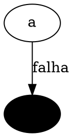

# Formato da especificação de cards (`*.cards.yaml`)

O arquivo `.cards.yaml` é a **fonte da verdade** do deck: fica no vault, sob controle do aluno, e
o `.apkg` é sempre regenerado a partir dele. Um arquivo representa um deck (com subdecks
opcionais). Exemplo completo: `../examples/exemplo-cc.cards.yaml`.

## Índice
Cabeçalho · Campos de nota · Tipos (basic, cloze, type, occlusion) · Markdown suportado ·
Blocos de código · Diagramas (dot, tree, schema, svg, mermaid) · Cores semânticas · O que vira tag

## Cabeçalho

```yaml
deck: "BD2::Transações"     # nome no Anki; "::" cria hierarquia
namespace: bd2-tx           # prefixo dos GUIDs. NUNCA mude depois de publicar
context_root: "BD2"         # primeiro item do breadcrumb de todo card (opcional)
lang: pt-BR
terms:                      # vocabulário travado (o linter acusa os "avoid")
  - prefer: "chave estrangeira"
    avoid: ["foreign key", "FK estrangeira"]
sources:                    # de onde vem o conteúdo (Wozniak 18)
  - id: aula05
    title: "Aula 05 — Transações"
    path: ../references/aulas/aula05.md   # opcional; relativo a este arquivo (gera hash no manifesto)
    url: https://...                       # opcional
notes: [...]
```

## Campos de nota

| campo | obrigatório | uso |
|---|---|---|
| `id` | sim | slug `a-z0-9-`. Vira o GUID. **Nunca renomeie um id publicado** (perde o histórico). |
| `type` | não | `basic` (padrão), `cloze`, `type`, `occlusion`. Inferido pelos campos. |
| `context` | recomendado | breadcrumb "Área › Tópico" (Wozniak 16). Também vira tag hierárquica. |
| `front` | basic/type | pergunta (Markdown) |
| `back` | basic | resposta (Markdown). Comece pela resposta-chave com `==marca-texto==`. |
| `text` | cloze | texto com `{{c1::...}}`, `{{c2::...}}` |
| `answer` | type | resposta digitada, **uma linha**, ≤ 40 caracteres |
| `diagram`, `occlude` | occlusion | bloco de diagrama + lista de alvos (um card por alvo) |
| `extra` | não | porquê, exemplo, mnemônico, contraste (aparece no verso, em destaque secundário) |
| `hint` | não | dica de toque, escondida até abrir (não pode conter a resposta) |
| `source`, `at` | não | id de `sources[]` + local ("slide 14", "p. 112") |
| `version` | não | "PostgreSQL 16", "Python ≥ 3.10" (Wozniak 19). Aparece no rodapé. |
| `level` | não | `basic` \| `core` (padrão) \| `advanced` |
| `priority` | não | 1 (cai na prova) … 3 (curiosidade). Padrão 2. |
| `prereqs` | não | ids que devem ser introduzidos antes (ordem de cards novos) |
| `pair` | não | ids do par confundível (card distinguidor, Wozniak 11) |
| `archetype` | não | ver `escrever-flashcards/references/arquetipos-cc.md` |
| `subdeck` | não | subdeck relativo: `deck::subdeck` |
| `tags` | não | tags extras (espaço vira `_`) |
| `lint_ignore` | não | avisos intencionais, com motivo: `["interferencia: variação do mesmo rastreio"]`. Erros não podem ser ignorados. Use isto, e não comentários YAML: o merge descarta comentários. |

Ordem de introdução dos cards novos: pré-requisitos primeiro; empate por `level`, depois
`priority`, depois a posição no arquivo.

## Tipos

**basic**: `front` + `back`.

**cloze**: `text` com `{{cN::conteúdo}}`. O conteúdo pode ter chaves balanceadas (`{"a": 1}`) e
`::` (`std::vector`) — o build protege. Não existe dica inline (`::dica`): use `hint`. Mesmo
número = mesmo card; números diferentes = cards irmãos.

**type** (digitar a resposta): `front` + `answer` (+ `back` opcional com explicação). Comparação
letra a letra no Anki/AnkiDroid: só para comandos curtos com forma canônica.

**occlusion** (oclusão de diagrama, Wozniak 8): um diagrama, vários alvos, um card por alvo.
```yaml
- id: er-matricula
  type: occlusion
  context: "BD › Modelo ER"
  front: "Que entidade falta no modelo?"          # opcional
  diagram: |
    ```dot
    graph { Aluno [shape=box]; Matricula [shape=diamond]; Curso [shape=box];
            Aluno -- Matricula -- Curso; }
    ```
  occlude: ["Aluno", "Curso"]     # nome do nó (dot), rótulo (tree) ou data-occ="..." (svg)
  back: "==**{alvo}**== — ..."    # opcional; {alvo} é trocado pelo alvo do card
```
Gera os ids `er-matricula--aluno` e `er-matricula--curso`. A frente mostra o diagrama com o alvo
virado "?" em marca-texto; o verso mostra o alvo revelado e destacado.

## Markdown suportado (em front, back, text, extra, hint)

- CommonMark + tabelas (`| a | b |`) + ~~riscado~~ + HTML cru (`<kbd>Ctrl</kbd>`, `<br>`)
- `==marca-texto==` (pode conter `código` e **negrito**): a resposta-chave
- Matemática: `\( ... \)` inline e `\[ ... \]` em bloco (MathJax nativo do Anki). Em YAML entre
  aspas duplas, escape a barra (`"\\(O(n)\\)"`); em bloco `|` não precisa.
- Imagem local `` → copiada para a mídia com nome por hash. Imagem remota não
  funciona offline no AnkiDroid.

## Blocos de código

````markdown
```python {hl=3 err=5 ok=6 dim=1-2 focus=3-6 title="busca.py" lines=no wrap}
...
```
````

| opção | efeito |
|---|---|
| `hl=2,4-5` | linhas destacadas (marca-texto) |
| `err=3` / `ok=4` | linha com erro (vermelho) / correta (verde) |
| `dim=…` / `focus=…` | apaga linhas / apaga tudo fora do foco |
| `title="x.py"` | legenda com nome do arquivo |
| `lines=no` / `lines=yes` | numeração (padrão: sim se > 3 linhas) |
| `wrap` | quebra linhas longas em vez de rolar (use só se não importar a indentação) |

Linguagens: qualquer uma do Pygments (`python`, `java`, `c`, `cpp`, `sql`, `bash`, `js`, `ts`, `go`,
`rust`, `kotlin`, `diff`…). `out`/`console`/`text` = saída de programa, sem realce. `diff` pinta
`+`/`-` de verde/vermelho.

Cloze dentro de código: escreva `{{c1::...}}` direto no código. Restrições: não atravessar linhas;
esconder um token/expressão (≤ 30 caracteres).

## Diagramas

Todos viram **SVG inline** que herda as cores do tema (claro/escuro). Opções comuns:
`{caption="..." width=70% hl=A,B}`.

**`dot`** (Graphviz): o padrão para grafos, ER, autômatos, fluxos, listas ligadas, pilhas.
Use cores semânticas (abaixo). `hl=No1,No2` destaca nós pelo nome.

**`tree`** (árvore binária, compacto): `8(3(1,6*),10(,14?))`
- `X(esq,dir)`; filho vazio = nada entre as vírgulas; `*` destaca; `?` esconde o rótulo (vira "?")

**`heap`** (árvore binária completa a partir de um **vetor base 0**: heaps, heapsort, índices):
```heap {show=vk hl=1 path=0-1-3 alert=1-4 hide=4 dashed=3-5}
[1, 3, 5, 7, 9, 6]
```
- `show`: `v` valor (padrão) · `k` índice · `vk` valor com `[índice]` embaixo
- `hl` destaca índices · `hide` troca o rótulo por "?" · `dashed` tracejado (ex.: folhas)
- `path=0-1-3` destaca as arestas do caminho · `alert=1-4` pinta a aresta pai-filho de vermelho
- Oclusão: `occlude: ["10"]` acha o nó pelo rótulo (valor ou índice).
Posições fixas: fica simétrico e estreito até 15–16 nós a 390 px.

**`schema`** (esquema relacional, notação de livro: PK sublinhada):
```schema
aluno(*id, nome, curso_id -> curso.id)
curso(*id, !nome)
```
`*` = PK · `->` = FK (gera a linha "x referencia y") · `!` = destaque.

**`svg`**: SVG escrito à mão (sanitizado). Use `currentColor` e cores semânticas; `data-occ="nome"`
num `<g>` torna o grupo alvo de oclusão; `data-hl` destaca.

**`mermaid`**: só se `mmdc` + Chromium estiverem instalados (ver `check_env.py`). Gera duas
versões (clara/escura). Prefira `dot` para tudo que ele faz.

## Cores semânticas (dot, svg, mermaid)

`@ink` (tinta) · `@accent` (estrutura/destaque) · `@accent-soft` (preenchimento suave) · `@muted` ·
`@mark` (marca-texto) · `@alert` / `@alert-soft` (erro) · `@ok` / `@ok-soft` (certo) · `@panel` · `@paper`


Nunca use cores fixas (`red`, `#336699`): somem ou ficam ilegíveis no tema escuro.

## O que vira tag automaticamente
`cc::tipo::<type>`, `cc::nivel::<level>`, `cc::prio::<n>`, `<namespace>::<contexto>`,
`fonte::<source>`, `cc::arq::<archetype>` + as suas `tags`. Assim dá para filtrar no Anki
("tag:cc::arq::distinguisher", "tag:bd2-tx::isolamento").
